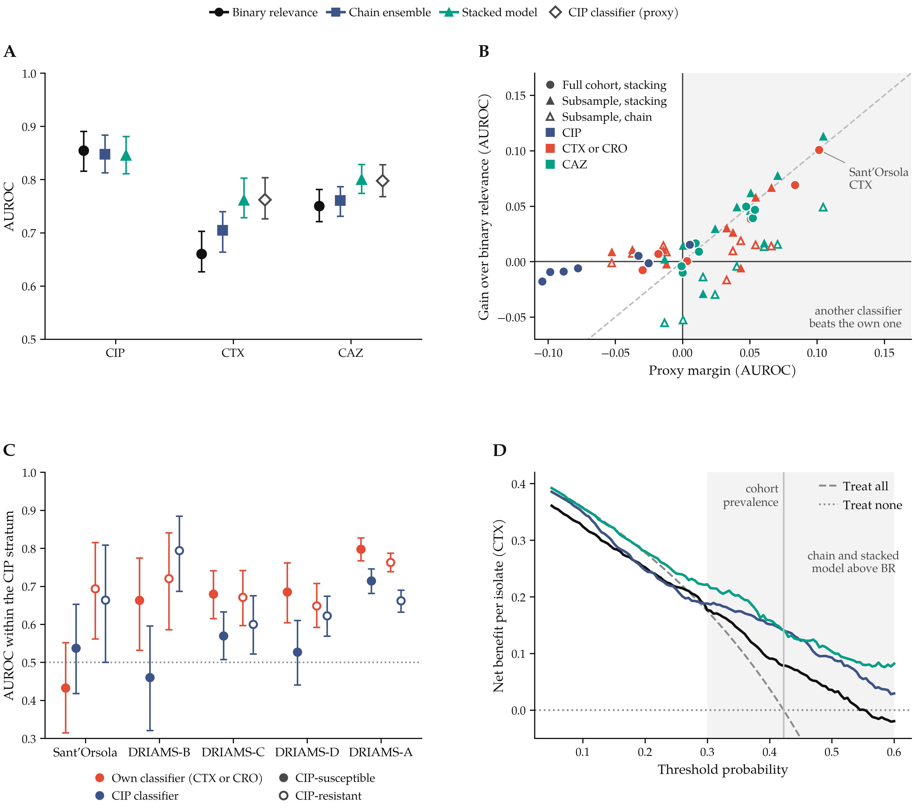

# maldi-ecoli-coresistance

**When does borrowing between antibiotics improve MALDI-TOF prediction of resistance?**

Analysis code for the article *A regime for exploiting resistance co-occurrence in machine learning prediction of* Escherichia coli *cephalosporin resistance from MALDI-TOF spectra*, by E. Rocchi, C. Crovara Pesce, C. Sala, D. Lombardo, R. Cetatean, G. Castellani and S. Ambretti.

Resistance phenotypes co-occur, so a model that predicts one antibiotic could borrow from the others, as classifier chains and stacking do. We find that borrowing pays off only where another antibiotic's classifier already predicts the label better than the label's own classifier does. We call this measurable quantity the **cross-prediction margin**.

* **Sant'Orsola, 187 bloodstream isolates.** The ciprofloxacin classifier predicted cefotaxime resistance better than the cefotaxime classifier (AUROC 0.762 versus 0.660). Cross-fitted stacking reached exactly this value, and the classifier chain captured part of it.
* **Four public DRIAMS sites, nearly 8,000 isolates.** The margin was at most 0.012, and no model gained materially.
* **Learning curves.** As training sets grew, the margin shrank and the gain shrank with it.

Laboratories can measure the margin on their own isolates before relying on co-resistance in a prediction model. We report stacking as an analytical result, not as a model to deploy.

<p align="center"></p>

## Quick start

```bash
git clone https://github.com/EttoreRocchi/maldi-ecoli-coresistance.git
cd maldi-ecoli-coresistance
python -m venv .venv && source .venv/bin/activate
pip install -r requirements/lock-core.txt && pip install -e .
make data all        # Sant'Orsola with logistic regression, a few hours
```

The Sant'Orsola spectra are on Zenodo ([10.5281/zenodo.20087613](https://doi.org/10.5281/zenodo.20087613)) and the DRIAMS collection on Dryad ([10.5061/dryad.bzkh1899q](https://doi.org/10.5061/dryad.bzkh1899q)); [data/README.md](data/README.md) gives the expected layout.

## Reproducing the article

| Target | Scope | Time on 128 cores |
|---|---|---|
| `make all` | Sant'Orsola, logistic regression | a few hours |
| `make driams` | four DRIAMS sites, with patient-grouped folds at DRIAMS-A | about a day |
| `make catboost`, `make tabpfn` | the two other learners (TabPFN in its own environment, GPU) | tens of hours each |
| `make summaries figures` | pooled statistics, every figure of the article | minutes |

The statistics behind every number of the article are versioned in `results/stats/`, so a rerun can be checked against them. [docs/reproduce.md](docs/reproduce.md) maps each figure and table to its script and covers patient grouping, software versions and fonts.

## Layout

`scripts/` holds one folder per section of the Results, from `00_data` to `07_transfer`, plus `figures_tables`; each folder has a short README and numbered scripts in running order. The package `mecor` (`src/mecor`) holds the code the scripts share, and `configs/` the settings of each site.

## Citation

If you use this code, please cite the article:

> Rocchi E, Crovara Pesce C, Sala C, Lombardo D, Cetatean R, Castellani G, Ambretti S. A regime for exploiting resistance co-occurrence in machine learning prediction of *Escherichia coli* cephalosporin resistance from MALDI-TOF spectra. Available soon.

## License

MIT (see [LICENSE](LICENSE)).
